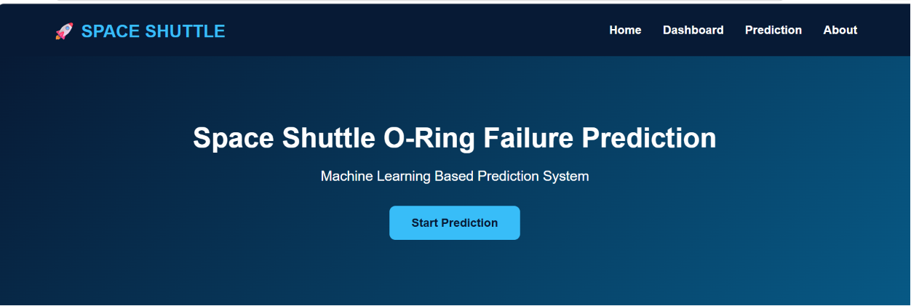
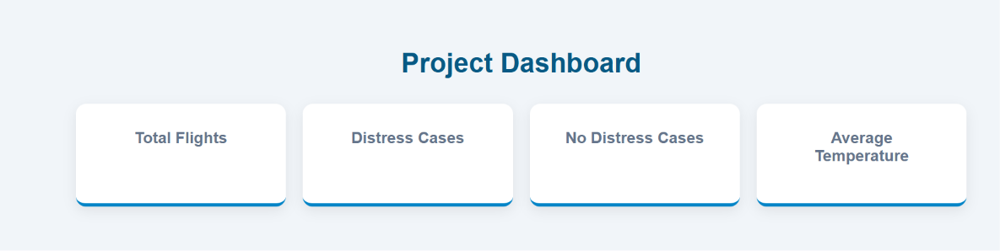
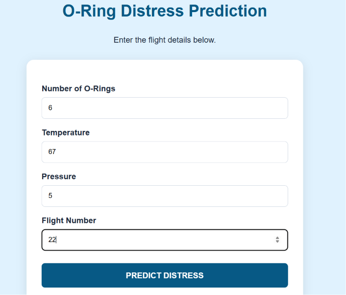

# Space Shuttle O-Ring Failure Prediction Using Machine Learning

## Project Overview

The Space Shuttle O-Ring Failure Prediction project is a Machine Learning-based web application that analyzes historical Space Shuttle flight data to predict the possibility of O-Ring distress.

The project uses Python and Scikit-learn to train a Machine Learning model and Flask to provide an interactive web application where users can enter flight parameters and view prediction results.

## Features

- Historical Space Shuttle flight data analysis.
- Data preprocessing and visualization.
- Machine Learning model training using Logistic Regression.
- O-Ring distress prediction.
- Interactive web application using Flask.
- User-friendly dashboard.
- Prediction results with estimated distress probability.

## Technologies Used

- Python
- Pandas
- NumPy
- Matplotlib
- Seaborn
- Scikit-learn
- Flask
- HTML
- CSS
- Jupyter Notebook

## Project Structure

```text
Space_Shuttle_O_Ring_Prediction/
│
├── Screenshots/
│   ├── space_shuttle_homepage.png
│   ├── space_shuttle_dashboard.png
│   ├── space_shuttle_prediction_form.png
│   └── space_shuttle_prediction_result.png
│
├── static/
│   └── style.css
│
├── templates/
│   └── index.html
│
├── Space_Shuttle_O_Ring_Failure_Prediction.ipynb
├── Space Shuttle.xlsx
├── space_shuttle_model.pkl
├── app.py
├── requirements.txt
└── README.md
```

## Dataset

The project uses historical Space Shuttle O-Ring data.

The dataset contains the following features:

- Number of O-Rings
- Distress Incidents
- Temperature
- Pressure
- Flight Number

The target variable is created from the Distress Incidents column to identify whether distress was recorded.

## Machine Learning Algorithm

**Logistic Regression**

The Logistic Regression algorithm is used to classify flight records into two categories:

- 0 – No O-Ring Distress
- 1 – O-Ring Distress

The trained model is saved as `space_shuttle_model.pkl` and loaded by the Flask application to make predictions.

## Project Screenshots

### 1. Home Page

The home page introduces the Space Shuttle O-Ring Failure Prediction application.



### 2. Project Dashboard

The dashboard displays project statistics, including total flights, distress cases, no-distress cases, and average temperature.



### 3. Prediction Form

Users can enter flight details such as the number of O-Rings, temperature, pressure, and flight number.



### 4. Prediction Result

The application displays the predicted O-Ring distress result along with the estimated distress probability.


## Installation and Setup

### 1. Clone the Repository

```bash
git clone https://github.com/NavyaRocky02/Space-Shuttle-O-Ring-Failure-Prediction.git
```

### 2. Open the Project Folder

```bash
cd Space-Shuttle-O-Ring-Failure-Prediction
```

### 3. Install Required Libraries

```bash
pip install -r requirements.txt
```

### 4. Run the Flask Application

```bash
python app.py
```

### 5. Open the Application

Open your browser and visit:

```text
http://127.0.0.1:5000/
```

## How to Use

1. Open the Space Shuttle O-Ring Prediction web application.
2. Enter the number of O-Rings.
3. Enter the temperature.
4. Enter the pressure.
5. Enter the flight number.
6. Click the Predict button.
7. View the predicted result and estimated distress probability.

## Project Outputs

- Data analysis and visualizations.
- Machine Learning model.
- Model performance evaluation.
- Actual versus predicted results.
- Interactive Flask dashboard.

## Disclaimer

This project is developed for educational and academic purposes. The dataset is small, and the predictions are based on historical observations. The model must not be used for actual spacecraft launch decisions or operational safety assessments.

## Author

**Navya Sree Challa**

**GitHub:** https://github.com/NavyaRocky02

**Project Repository:** https://github.com/NavyaRocky02/Space-Shuttle-O-Ring-Failure-Prediction
